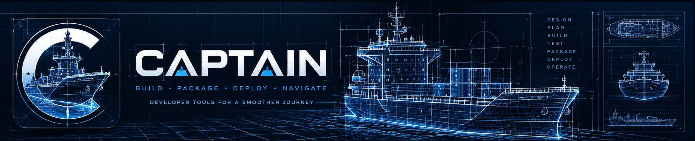
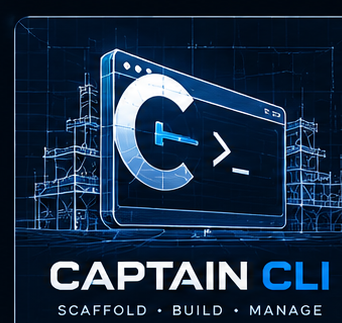
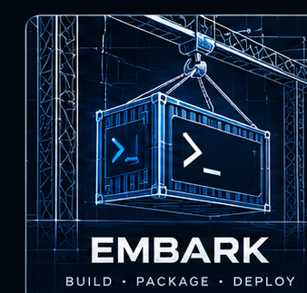

  

<h1 align="center">Captain</h1>

<strong>Build the ship. Equip the crew. Launch with confidence.</strong>

A modular toolkit for orchestrating software builds, packaging, setup, and deployment workflows.

  <a href="https://github.com/captain-cli/captain">Captain</a> ·
  <a href="https://github.com/captain-cli/captain-core">Core</a> ·
  <a href="https://github.com/captain-cli/embark">Embark</a> ·

---

## The shipyard

Software delivery is more than compiling source code. It takes coordination: preparing workspaces, validating configuration, staging artifacts, assembling packages, and managing the transitions between each step.

**Captain** brings those jobs together as a collection of focused, composable tools. Each component has a responsibility; together, they form an engineering workflow from source to ship.

| Stage | Responsibility | Project |
|:--|:--|:--|
| **Command** | Coordinate developer workflows | [Captain](https://github.com/captain-cli/captain) |
| **Foundation** | Shared orchestration capabilities | [Captain Core](https://github.com/captain-cli/captain-core) |
| **Stage** | Prepare build artifacts for packaging | [Stager](https://github.com/captain-cli/stager) |
| **Equip** | Define and manage application/package configuration | [Outfit](https://github.com/captain-cli/outfit) · [Outfit Registry](https://github.com/captain-cli/outfit-registry) |
| **Package** | Assemble native Linux packages | [Embark](https://github.com/captain-cli/embark) |
| **Support** | Specialized generation and development utilities | [SchemaWright](https://github.com/captain-cli/schemawright) · [ServiceWright](https://github.com/captain-cli/servicewright) · [Dockhand](https://github.com/captain-cli/dockhand) |

## Meet the crew

<table>
  <tr>
    <td width="33%" align="center" valign="top">
       
      <strong>Captain</strong> 
      The orchestration layer that brings tools and workflows together.
    </td>
    <td width="33%" align="center" valign="top">
       
      <strong>Embark</strong> 
      Native Linux packaging for Debian and RPM-oriented delivery.
    </td>
  </tr>
</table>

## Design philosophy

- **One crew, clear responsibilities.** Keep modules focused and interoperable.
- **Repeatable by design.** Prefer documented, reproducible operations over one-off commands.
- **Use the platform.** Lean on native Linux package and service conventions where appropriate.
- **From local development to delivery.** Treat setup, staging, packaging, and deployment as connected engineering concerns.
- **Build for real workloads.** Let practical deployment scenarios drive the toolchain.

## Explore the projects

Browse the [organization repositories](https://github.com/orgs/captain-cli/repositories) for implementation details, current development status, and repository-specific instructions. The ecosystem is under active development; consult individual repositories before relying on a feature or package for production use.

---

Captain — engineer the journey from source to ship.

